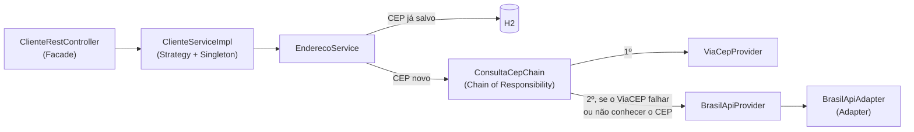

# Explorando Padrões de Projetos na Prática com Java

API REST de clientes em Spring Boot. O endereço de cada cliente é preenchido sozinho a partir do CEP. Desafio da DIO sobre padrões de projeto (GoF).

Baseado no [lab original da DIO](https://github.com/digitalinnovationone/lab-padroes-projeto-spring), que usava **Singleton**, **Strategy** e **Facade**. Esta versão acrescenta **Chain of Responsibility** e **Adapter**, corrige bugs e atualiza o projeto para Spring Boot 4 e Java 21.

## Como funciona



Ao cadastrar um cliente com o CEP `54800-000`:

1. O CEP é validado e normalizado (`54800000`).
2. Se ele já está no banco, o endereço salvo é reaproveitado e nenhuma API é chamada.
3. Se não está, a corrente pergunta ao ViaCEP. Se o ViaCEP cair, demorar ou não conhecer o CEP, ela pergunta à BrasilAPI.
4. O endereço é salvo com o nome do serviço que respondeu (campo `fonte`).

## Onde está cada padrão

| Padrão | No código |
| --- | --- |
| **Singleton** | Os `@Service`, `@Component` e clients HTTP são criados uma única vez pelo Spring e injetados pelo construtor. |
| **Strategy** | `ClienteService` (do lab original) e `CepProvider`. Cada serviço de CEP é uma estratégia intercambiável. Para adicionar um terceiro, basta criar outra classe com `@Component` e `@Order`, sem mexer no resto. |
| **Chain of Responsibility** | `ConsultaCepChain` passa a consulta pelos providers em ordem até um responder. Quem chama não sabe quantos serviços existem nem a ordem deles. |
| **Adapter** | `BrasilApiAdapter` converte o formato da BrasilAPI (`state`, `city`, `street`...) para o `Endereco` do domínio. |
| **Facade** | `ClienteRestController` e `ClienteServiceImpl`: para cadastrar um cliente basta informar nome e CEP, sem saber de banco, cache ou APIs externas. |

## Evoluções em relação ao lab original

**Bugs corrigidos**
- **`PUT` criava outro cliente.** O cliente da requisição era salvo sem `id`, então virava um registro novo. Agora o cliente existente é alterado (há um teste para isso).
- **Cliente inexistente dava erro 500** (`Optional.get()` em `NoSuchElementException`). Agora responde `404`, inclusive no `PUT` e no `DELETE`.
- **CEP inexistente quebrava o cadastro.** O ViaCEP responde `{"erro": true}` com status 200, e esse "endereço" sem CEP era salvo. Agora a resposta é `422` com uma mensagem clara.
- **CEP em formato errado chegava até a API externa.** Agora é recusado com `400` antes de qualquer consulta, e `55610-000`, `55.610-000` e `55610000` são tratados como o mesmo CEP.

**Melhorias**
- **Fallback entre ViaCEP e BrasilAPI**, com timeouts curtos. Se os dois estiverem fora do ar, a resposta é `503`.
- **Erros no padrão Problem Details (RFC 9457)**, com título e mensagem em português:
  ```json
  { "status": 404, "title": "Cliente não encontrado", "detail": "Cliente 999 não encontrado." }
  ```
- **DTOs com validação** (`@NotBlank`, `@Size`) em vez de expor as entidades JPA. O cliente envia só `nome` e `cep`.
- **Status HTTP corretos:** `201 Created` com `Location` no cadastro e `204 No Content` na remoção.
- **Novo endpoint `GET /ceps/{cep}`** para consultar um endereço e ver qual serviço respondeu.
- **Atualização para Spring Boot 4.1 e Java 21.** O OpenFeign (que exigia o Spring Cloud) foi trocado pelas *HTTP Interfaces* nativas do Spring (`@GetExchange`). Também passam a ser usados injeção por construtor, `jakarta.*` e records.
- **25 testes automatizados:**
  - unitários do CEP, da corrente e do adapter;
  - de ponta a ponta com MockMvc e H2.
  - As APIs externas são simuladas, então os testes rodam sem internet.

## Como rodar

Requer JDK 21 ou superior. O Maven vem junto (`mvnw`).

```bash
./mvnw spring-boot:run      # Windows: mvnw.cmd spring-boot:run
./mvnw test
```

- Swagger UI: http://localhost:8080/swagger-ui.html
- Console do H2: http://localhost:8080/h2-console (JDBC URL `jdbc:h2:mem:gof`, usuário `sa`, sem senha)

### Exemplos

```bash
curl -i -X POST localhost:8080/clientes \
  -H "Content-Type: application/json" \
  -d '{"nome": "Ana", "cep": "54800-000"}'
```

```
HTTP/1.1 201
Location: /clientes/1

{"id":1,"nome":"Ana","endereco":{"cep":"54800-000","logradouro":"","complemento":null,"bairro":"","localidade":"Moreno","uf":"PE","fonte":"BrasilAPI"}}
```

O ViaCEP não conhece esse CEP (é o CEP geral de Moreno), então a resposta veio da BrasilAPI. Já um CEP como `01001-000` é respondido pelo próprio ViaCEP:

```bash
curl localhost:8080/ceps/01001000
```

```json
{"cep":"01001-000","logradouro":"Praça da Sé","complemento":"lado ímpar","bairro":"Sé","localidade":"São Paulo","uf":"SP","fonte":"ViaCEP"}
```

| Método | Rota | Resposta |
| --- | --- | --- |
| `GET` | `/clientes` | `200` com a lista |
| `GET` | `/clientes/{id}` | `200` ou `404` |
| `POST` | `/clientes` | `201`, `400` (dados ou CEP inválidos), `422` (CEP inexistente) ou `503` |
| `PUT` | `/clientes/{id}` | `200`, `404`, `400`, `422` ou `503` |
| `DELETE` | `/clientes/{id}` | `204` ou `404` |
| `GET` | `/ceps/{cep}` | `200`, `400`, `422` ou `503` |
